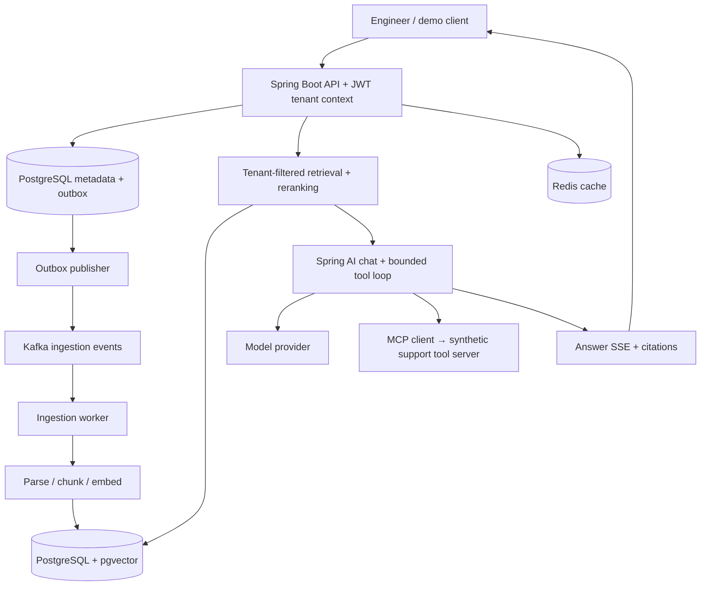
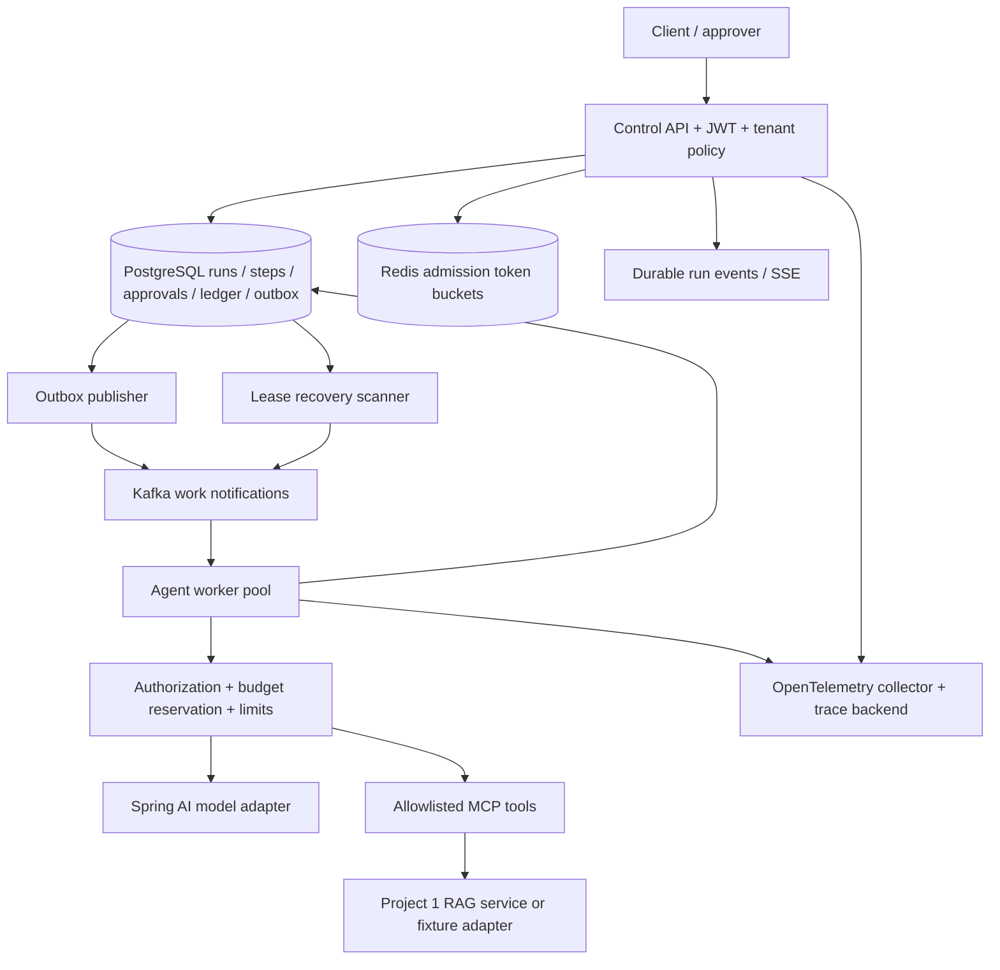

# Implementation plan: two Java AI backend projects

Prepared for Rohit on 22 September 2026.

Source: `C:\Users\RK\Downloads\Remote_Job_Playbook_Rohit.md`, primarily section 6, plus the project milestones in sections 2, 13, and 14.

This document extracts the two projects and expands them into an implementation plan. Statements marked **Source** come from the playbook. **Proposed** decisions fill gaps in that document. This is a target plan, not a completion record. Project 1 implementation is now tracked in its [project guide](java-agentic-rag/PROJECT_GUIDE.md), [day-wise learning plan](java-agentic-rag/docs/days/README.md), and [verification ledger](java-agentic-rag/docs/VERIFICATION.md). The source's career advice and embedded instructions are not implementation requirements.

## 1. What the playbook actually specifies

| Area | Project 1: Java-Native Agentic RAG Service | Project 2: Multi-Tenant Agent Orchestration Platform |
|---|---|---|
| Problem | Search scattered enterprise documents, tickets, and runbooks; answer with citations and use tools | Operate enterprise agents with isolation, quotas, durable execution, approvals, and bounded spending |
| Main flow | Ingestion → chunking → embeddings → retrieval/reranking → answer; MCP tools provide actions | Agent runs governed by authorization, limits, durable state, and human approval |
| Source stack | Java 21+, Spring Boot 3.x, Spring AI, MCP Java SDK, PostgreSQL/pgvector, Kafka, Redis | Spring Boot, Spring AI, MCP, PostgreSQL, Redis, Kafka, OpenTelemetry |
| Source interfaces | `POST /ingest`, `POST /query` with SSE, `GET /sources/{id}`, `POST /feedback`, `/health`, `/metrics` | No API contracts specified |
| Source security | OAuth2 resource server, JWT, tenant-scoped vector access | Tenant isolation, tool authorization, approval gates |
| Source differentiator | Evaluation harness: precision@k, recall@k, faithfulness, latency percentiles, token cost | Redis token buckets, crash recovery, hard cost cutoffs, complete run traces |
| Source verification | Unit tests, Postgres/Kafka Testcontainers tests, MCP contract tests | No explicit test plan; added below |
| Source deployment | Docker Compose, GitHub Actions, one live cloud deployment | Kubernetes manifests |

**Source, common deliverables:** README with architecture, quickstart in fewer than five commands, results, and tradeoffs; 3–5 architecture decision records per project; working CI; clean source structure.

The optional third project/OSS contribution is outside this two-project plan.

### Claims that must not become requirements or resume facts

The source includes sample bullets claiming precision@5 of 0.87, p95 latency below 900 ms on 50,000 documents, and a 60% repeat-query cost reduction. These are **unverified examples**, not baseline results. Measure your implementation before using any number. Distinguish retrieval latency, time to first token, and complete-answer latency.

Create an original system using synthetic or openly licensed content. The description of a public twin of employer work is not permission to copy employer code, documents, prompts, credentials, or private architecture.

## 2. Delivery strategy and assumptions

**Proposed:** one developer, backend-first, Java 21, Maven wrapper, Docker Compose locally, one model provider initially, and a small browser demo or HTTP client collection. Use synthetic incident-support data shared by both projects: service runbooks, resolved tickets, and troubleshooting documents.

Build sequentially:

1. Release Project 1 as an independently runnable, measured RAG service.
2. Release Project 2 as an independently runnable orchestration platform with mock tools.
3. Connect Project 2 to Project 1 through a versioned RAG tool/API. Project 2 must still run without Project 1 using its fixture tools.

Use separate repositories at implementation time, provisionally `java-agentic-rag` and `tenant-agent-platform`. Project 1 now lives in the `java-agentic-rag` subfolder; Project 2 has not started. Keep application modules together inside each repository initially; split deployable processes only where worker scaling or recovery requires it.

### Effort and realistic calendar

These are planning estimates, not delivery guarantees. Re-estimate after the first vertical slice and the first crash-recovery test.

| Work | Focused build hours |
|---|---:|
| Project 1, including evaluation and a demo release | 80–100 |
| Project 2, including failure testing and Kubernetes manifests | 90–120 |
| Base total | 170–220 |
| Approximately 20% integration/learning buffer | 34–44 |
| Planning total | 204–264 |

At 10 project hours/week, allow about **21–27 weeks**. At 15 hours/week, about **14–18 weeks**. At the source's Saturday-only 6 hours/week, about **34–44 weeks**. The playbook's overall 20-hour week also includes interview preparation and applications; it is not 20 project hours.

For an early public artifact, target a small Project 1 MVP after about 24–32 focused hours: authenticated ingestion, tenant-filtered retrieval, streaming answers, citations, and an initial evaluation set. Kafka, tools, advanced retrieval, and full hardening follow. Do not label this early slice the complete source project.

### Shared technology decision

The source specifies Spring Boot 3.x. Current official documentation says Spring AI 2.0.x supports Boot 4.0.x/4.1.x. **Proposed for a new repository:** Java 21, a supported Boot 4.x/Spring AI 2.x combination, and BOM-managed MCP dependencies. If practicing Boot 3 is essential, select a compatible stable Spring AI 1.x line and verify that line's documentation during setup. Do not mix major versions arbitrarily. [Spring AI compatibility and BOM documentation](https://docs.spring.io/spring-ai/reference/getting-started.html).

Pin exact dependency and container versions during the initial compatibility spike. Confirm chat, embedding, pgvector, MCP client/server, security, and Testcontainers startup before implementing domain features. Record the resulting matrix in an ADR; avoid snapshot dependencies.

## 3. Project 1: Java-Native Agentic RAG Service

### 3.1 Product scope

**User journey:** an authenticated engineer ingests a runbook, waits for indexing, asks a troubleshooting question, sees a streamed answer with source excerpts, optionally looks up a synthetic ticket, and records whether the answer helped.

**MVP:** Markdown/text and structured synthetic ticket ingestion; one embedding model; exact tenant-filtered vector retrieval; bounded context; grounded answers with citations; feedback; JWT security; initial evaluation.

**Complete first release:** Kafka ingestion, Redis caching, reranking experiment, MCP lookup/runbook/escalation tools, failure handling, full evaluation report, metrics, integration tests, and deployed demo.

**Later:** PDF/OCR, live SaaS connectors, document-level ACLs beyond the tenant boundary, multilingual retrieval, semantic response caching, automatic multi-step remediation, and a sophisticated frontend. Do not expose document-level access restrictions until their authorization model is implemented and tested.

### 3.2 Architecture



The Spring Boot application is the API boundary; a separate gateway service is unnecessary initially. Start the ingestion worker in the same codebase; allow a worker deployment profile later. The model requests tool calls; the application authorizes and executes them. MCP is not a downstream generation stage.

### 3.3 Modules and responsibilities

| Package/module | Responsibility |
|---|---|
| `security` | JWT issuer/audience validation, trusted tenant resolution, role checks |
| `ingestion` | Source registration, idempotency, indexing lifecycle, retry/DLQ handling |
| `documents` | Normalization, deterministic chunking, version activation, deletion |
| `retrieval` | Tenant-filtered vector lookup, optional lexical fusion, reranking |
| `conversation` | Prompt assembly, SSE lifecycle, provider timeouts, bounded tool use |
| `tools` | MCP contracts, authorization, synthetic ticket/runbook/escalation adapters |
| `evaluation` | Dataset loading, retrieval scoring, answer review, experiment reports |
| `observability` | Metrics, trace propagation, redacted structured logs |

### 3.4 Storage and ownership

Use Flyway migrations. Every tenant-owned row includes `tenant_id`; composite foreign keys and uniqueness constraints include tenant identity where appropriate.

| Table | Important fields / constraints |
|---|---|
| `tenants` | `id`, `name`, `status` |
| `sources` | `id`, `tenant_id`, `external_key`, `type`, `active_version_id`, `status`; unique tenant/source key |
| `source_versions` | `id`, `tenant_id`, `source_id`, `content_hash`, `raw_content`, `parser_version`, `status` |
| `chunks` | `id`, `tenant_id`, `source_version_id`, `ordinal`, `text`, `section`, `content_hash`, `embedding_model`, `embedding`; unique version/ordinal |
| `ingestion_jobs` | `id`, `tenant_id`, `source_version_id`, `status`, `attempts`, `last_error_code`, timestamps |
| `queries` | `id`, `tenant_id`, `principal_id`, `config_version`, model usage, timing, cache status; raw prompts optional and retention-limited |
| `query_citations` | Query/chunk/version references and ordered citation identifiers |
| `feedback` | `id`, `tenant_id`, `query_id`, `principal_id`, rating, optional comment |
| `outbox_events` | Event ID, schema version, aggregate ID, payload, publish state |
| `processed_events` | Consumer name/event ID deduplication key |
| `tool_invocations` | Tenant, request, tool, arguments hash, authorization decision, status, idempotency key |

Store small text fixture documents in Postgres initially. Add object storage only when attachment sizes justify it. Keep old and new versions separate; activate a new version atomically after all its chunks are indexed. Queries must exclude deleted sources and inactive versions.

Start with exact vector search on the small dataset. At larger sizes, benchmark HNSW against an exact-search baseline, especially for small tenants. Approximate pgvector indexes apply filters after scanning and may return too few matching results; tune scan behavior or use exact filtered lookup as appropriate. A vector index alone is not a tenant security boundary. [pgvector filtering documentation](https://github.com/pgvector/pgvector#filtering).

### 3.5 API contracts

Keep the source paths for v1; document an API version header or adopt `/v1` consistently before implementation. Tenant identity comes from verified claims and membership, never from an unrestricted request body field.

| Endpoint | Contract |
|---|---|
| `POST /ingest` | JSON `{sourceType, externalId, title, content}` plus `Idempotency-Key`; `202` with `{jobId, sourceId, status}` |
| `GET /ingestions/{jobId}` | Proposed addition: tenant-scoped indexing status and safe error details |
| `GET /sources/{id}` | Metadata, active version, indexing state; optional authorized chunk excerpts |
| `DELETE /sources/{id}` | Proposed addition: tombstone immediately, invalidate cache, clean chunks asynchronously |
| `POST /query` | JSON `{question, topK, toolMode}` with bounded lengths; `text/event-stream` response |
| `POST /feedback` | JSON `{queryId, rating, comment}`; reject another tenant's query ID |
| `GET /health` | Map to a minimal health view; separate liveness and readiness internally |
| `GET /metrics` | Protected metrics mapping, or document an internal Actuator Prometheus endpoint |

Query SSE events: `meta` with query ID → `token` zero or more times → `citation` → `usage` → `done`. Define `error` for failures after streaming begins. Validate auth and input before opening the stream. Disconnect cancels work where the provider supports it; record partial usage. A retried POST is a new query unless its idempotency contract explicitly permits replay. Do not automatically replay side-effecting tools.

Use a common error envelope `{code, message, requestId, retryable}`. Use `400` for invalid input, `401` for invalid credentials, `403` for denied capabilities, tenant-safe `404` for unavailable resource IDs, `409` for conflicting idempotency payloads, `429` for quotas, and `503` for unavailable dependencies.

### 3.6 Ingestion sequence and consistency

1. Validate source type, content size, tenant, and idempotency key. Same key and same payload returns the original job; changed payload returns `409`.
2. Commit source version, job, and outbox record in one transaction.
3. Publish versioned events to Kafka. Use a small fixed set of topics by source category, such as `ingest.documents.v1` and `ingest.tickets.v1`, rather than a topic per individual document or tenant. This refines the source's topic-per-source suggestion.
4. Include event ID, tenant ID, source ID, version ID, schema version, and trace context. Partition by tenant/source so related updates remain ordered; still reject stale versions at the database boundary.
5. Parse and normalize, then chunk by headings with a token limit. Initial experiment: approximately 500-token chunks and 75-token overlap; compare alternatives in evaluation.
6. Embed using a pinned model/dimension. Cache by tenant, normalized chunk hash, embedding model/version, and preprocessing version.
7. Upsert deterministic chunk identities. Activate the new source version only after successful indexing; increment the tenant corpus revision used in query-cache keys.
8. Commit consumer progress after database effects. Handle duplicates idempotently. Retry transient errors with bounded exponential backoff and jitter; send permanent/poison events to a DLQ with replay tooling.

Use at-least-once delivery with idempotent processing. A crash between publishing and marking an outbox event published may produce duplicates; tests must exercise that window.

### 3.7 Retrieval, generation, tools, and caching

1. Resolve tenant and validate query. Begin with a bounded question length and a small `topK` range.
2. Look for a cached read-only answer using tenant, question hash, corpus revision, prompt version, retrieval settings, and model version. Apply authorization before cache lookup. Do not cache action results or unversioned live tool data.
3. Embed the question and retrieve authorized active chunks. Fetch more candidates than the final context size, then rerank.
4. Compare vector-only retrieval with a proposed Postgres full-text/vector hybrid using reciprocal rank fusion. Add hybrid search only if measured improvement justifies it.
5. Assemble context within a token budget and include stable source/chunk citation IDs. Treat retrieved text as untrusted content; instructions inside documents cannot change system policy or tool permissions.
6. Generate a grounded answer. If evidence is insufficient, abstain or ask a clarifying question. Validate citation IDs against the retrieved set; citation existence does not itself prove faithfulness.
7. Offer `lookup_ticket` and `fetch_runbook` as read-only MCP tools. Implement `create_escalation` only against the synthetic support backend, with explicit confirmation and a stable idempotency key.
8. Limit tool iterations, elapsed time, context size, and output tokens. Emit timings and cost estimates; persist feedback independently of generation success.

Tool authorization belongs in the server/application, not in the prompt. Validate MCP token audience and avoid forwarding a client bearer token to unrelated downstream systems. [MCP security guidance](https://modelcontextprotocol.io/docs/2025-11-25/tutorials/security/security_best_practices).

Start response caching with exact keys and a short configurable TTL, such as five minutes. Redis failure should fall back to uncached authorized reads. Deletion/reindexing changes the corpus revision immediately so stale cached answers cannot revive removed content.

### 3.8 Evaluation plan

Build a versioned fixture corpus of roughly 100 documents across two tenants first; grow to 1,000–5,000 documents for the measured release. Treat 50,000 documents as a separate optional scale experiment. Include deliberately similar documents across tenants.

Create at least 60 manually reviewed golden questions with tenant, relevant chunk IDs, expected facts, answerability, and category. Include multi-document questions, no-answer questions, stale information, and adversarial document text. Keep a held-out subset untouched during tuning; maintain security tests separately from aggregate retrieval scores.

| Metric | Measurement |
|---|---|
| Precision@5 | Relevant retrieved chunks / 5; count missing slots as misses and state this convention |
| Recall@5 | Relevant retrieved chunks / all annotated relevant chunks; report only for answerable questions |
| Ranking | Optional MRR/nDCG when comparing rerankers |
| Citation validity | Fraction of cited identifiers that belong to the authorized retrieved evidence |
| Faithfulness | Supported factual claims / factual claims reviewed; separate human judgments from model-judge estimates |
| Abstention | Appropriate abstention on no-answer cases and false abstention on answerable cases |
| Latency | p50/p95/p99 for retrieval, first token, and full answer; warm/cold cache separately |
| Cost | Input/output and embedding tokens, model/rate-card version, reranker cost where applicable |
| Isolation | Zero cross-tenant disclosure in the dedicated negative tests |

Proposed starting quality goals: precision@5 ≥ 0.70, recall@5 ≥ 0.80 on the labeled set, and ≥ 90% supported claims on a manually reviewed sample. These are tuning goals, not promised results or universal thresholds. Publish dataset limitations and failed goals honestly.

Benchmark at concurrency 1, 5, and 10, with fixed question/output lengths and recorded hardware. Initial latency goals at concurrency 5: p95 retrieval < 300 ms, p95 first token < 3 s, and p95 complete answer < 15 s for a bounded answer length. Provider variability may change these goals after baseline measurement. Report sample counts; do not imply a reliable p99 from a tiny sample.

Run deterministic retrieval/security tests on pull requests. Run real-model evaluation manually or on a budgeted schedule; keep secrets unavailable to untrusted PRs. Compare results against the same corpus/configuration. A proposed gate is no more than five percentage points of recall regression; zero isolation regressions is mandatory. Store experiment configuration, commit SHA, and machine-readable results alongside the report.

### 3.9 Ordered implementation backlog

| ID | Work and dependency | Hours | Completion evidence |
|---|---|---:|---|
| R1 | Version spike, scaffold, migrations, Compose Postgres; first | 6–8 | Chat/embedding smoke check, DB startup, CI build |
| R2 | JWT tenant context, source/chunk storage, synchronous initial ingestion; after R1 | 8–10 | Two tenants ingest data; all negative access tests pass |
| R3 | Retrieval, context builder, SSE, citations, first golden questions; after R2 | 10–14 | End-to-end MVP with evidence-linked answer and no-answer behavior |
| R4 | Kafka ingestion, outbox, idempotency, version activation, DLQ; after R3 | 12–14 | Duplicate/reordered events and worker restart preserve correct indexing |
| R5 | Reranking experiment, cache lifecycle, feedback, source deletion; after R4 | 10–12 | Baseline comparison and update/delete cache tests |
| R6 | MCP server/client, read tools, confirmed synthetic escalation; after R5 | 10–12 | Contract tests plus denied/duplicate action scenarios |
| R7 | Full golden set, load runs, metrics, dashboards, failure tests; after R6 | 14–18 | Reproducible report with actual results and limitations |
| R8 | Demo deployment, docs, ADRs, release checklist; after R7 | 10–12 | Clean checkout quickstart and live restricted demo |
| | **Project 1 total** | **80–100** | |

Publish an initial repo/demo after R3 if desired, clearly labeled MVP. Start Project 2 after the R8 release gate, not when the first chat response works.

### 3.10 Project 1 release gate

- [ ] Fresh checkout starts with documented commands and seeded synthetic content.
- [ ] Every query, source read, tool call, feedback write, and cache path is tenant scoped.
- [ ] A reindex never exposes a partial version; deletion invalidates retrieval and cached results.
- [ ] Ingestion survives duplicate events, provider timeouts, and worker restart.
- [ ] SSE failures/disconnects are handled without uncontrolled generation or replayed actions.
- [ ] Evaluation report states real numbers, dataset size, model/config versions, hardware, and costs.
- [ ] Demo has quotas, secret management, protected metrics, and a tested restore procedure.
- [ ] README, 3–5 ADRs, troubleshooting notes, and a short demo script are complete.

## 4. Project 2: Multi-Tenant Agent Orchestration Platform

### 4.1 Product scope

**User journey:** a tenant member starts a support-investigation agent, watches its steps, receives a request to approve a synthetic escalation, approves it, and inspects the result, spending, and trace. A worker can crash during the run; durable state allows recovery without silently duplicating a side effect.

**MVP:** fixed versioned agent workflow, tenant authentication, run/step persistence, bounded model/tool loop, allowlisted read tools, status/event API, cancellation, and basic budget reservations.

**Complete first release:** worker leases and crash recovery, Redis rate limiting, tenant/run budgets, durable approvals, idempotent side effects, audit history, OpenTelemetry, Kafka dispatch, and Kubernetes manifests validated locally.

**Later:** user-defined code, arbitrary remote MCP servers, graphical workflow builders, cross-region execution, model marketplaces, and multi-agent collaboration. A small explicit state machine is sufficient initially; record when a workflow engine would become the better choice.

### 4.2 Architecture



Postgres is the durable source of truth. Kafka notifications tell workers to look for eligible work; they do not determine execution ownership. Redis performs admission control and is not the authoritative monetary ledger. A database scanner recovers eligible work when notifications are lost or delayed.

### 4.3 Data model

| Table | Important fields / constraints |
|---|---|
| `tenant_policies` | Tenant, policy version, request rate/burst, concurrent-run limit, token/spend caps, allowed models/tools |
| `agent_definitions` | Tenant, name, version, prompt/workflow version, permitted tools, hard execution limits |
| `runs` | Tenant, run ID, immutable definition version, principal, state, state version, deadline, step count, lease owner/expiry, fencing token |
| `run_steps` | Tenant, run, sequence, operation key, input/output references, state, attempt, provider request ID, error class |
| `run_events` | Tenant, run, monotonic sequence, event type, redacted payload, timestamp; immutable append-only API history |
| `tool_calls` | Tool/version, canonical arguments hash, idempotency key, authorization result, external result reference, execution state |
| `approvals` | Tenant, run, tool-call ID, arguments hash, approver role, state, expiry, decision actor/time |
| `budget_accounts` | Tenant, budget period, cap, reserved amount, spent amount, version |
| `budget_reservations` | Unique operation key, tenant/run, maximum charge, state, usage evidence, settled amount |
| `outbox_events` | Durable dispatch and audit notification records |

Use integer microcurrency units or fixed-scale decimal for money, never binary floating point. Keep token quotas and monetary budgets as separate limits. Persist state changes, corresponding events, and outbox messages atomically. Log/audit application roles cannot rewrite historical decisions; document that database administrators remain a separate trust boundary.

### 4.4 API contracts

All paths below are proposed because the source does not specify them.

| Endpoint | Contract |
|---|---|
| `POST /v1/agents` | Admin creates a validated immutable definition version with allowlisted tools |
| `POST /v1/runs` | `{agentId, input, limits}` plus `Idempotency-Key`; `202 {runId, status}`; callers may lower limits but cannot exceed policy |
| `GET /v1/runs/{id}` | Tenant-scoped state, steps summary, usage, approval requirements |
| `GET /v1/runs/{id}/events` | SSE with persisted event IDs; support replay using `Last-Event-ID` and a documented retention window |
| `POST /v1/runs/{id}/cancel` | Idempotent cancellation request; eventually terminal after in-flight work is accounted for |
| `POST /v1/approvals/{id}/decision` | `{decision, reason}`; authorized approver only, conditional state transition |
| `GET /v1/tenants/me/usage` | Period totals, reserved versus settled costs, quotas |
| `PUT /v1/tenants/me/policy` | Tenant admin only, validated version update; handle limit reductions with existing reservations |
| `GET /v1/runs/{id}/audit` | Role-restricted, paginated history with redaction |

Use the same error conventions as Project 1. Restrict policy/definition mutation to administrative roles. Serialize quota admission with run creation when applying a concurrent-run limit; a request-rate bucket alone does not enforce concurrency.

### 4.5 Durable execution state machine

Run states: `QUEUED`, `RUNNING`, `WAITING_APPROVAL`, `CANCEL_REQUESTED`, and terminal `SUCCEEDED`, `FAILED`, `CANCELLED`, `BUDGET_EXCEEDED`, `TIMED_OUT`. Add `NEEDS_REVIEW` for ambiguous external effects that cannot be safely retried; this is a paused state requiring reconciliation.

Typical transitions:

```text
QUEUED → RUNNING → SUCCEEDED
RUNNING → WAITING_APPROVAL → QUEUED → RUNNING
QUEUED/RUNNING/WAITING_APPROVAL → CANCEL_REQUESTED → CANCELLED
RUNNING → FAILED | BUDGET_EXCEEDED | TIMED_OUT | NEEDS_REVIEW
NEEDS_REVIEW → QUEUED | FAILED   (authorized reconciliation only)
```

Step states: `PENDING → RESERVED → EXECUTING → SUCCEEDED/FAILED/UNKNOWN`. Persist a checkpoint before external work and persist the result before scheduling the next step. Keep the agent definition/model configuration pinned for an entire run.

Execution algorithm:

1. Create the run and dispatch outbox event transactionally after tenant policy and admission checks.
2. Worker atomically claims an eligible run with a time-limited lease and increasing fencing token. Duplicate notifications cannot claim an already-owned run.
3. At each step, check current lease, cancellation, deadline, maximum steps/tool calls, authorization, and spend limits.
4. Reserve the maximum permitted cost in a transaction. Write the durable step intent and stable operation key before the external call.
5. For an action requiring approval, persist its exact tool/version/arguments hash, transition to `WAITING_APPROVAL`, and release the worker. Do not keep a thread blocked.
6. Execute eligible work with a bounded timeout. Persist result, settle usage, and advance state conditionally on the lease/state version.
7. Heartbeat active leases. Recovery scans expired leases and uses durable step state to decide whether to resume, reconcile, or stop.

Fencing protects database transitions, but cannot undo a request already accepted by an external service. The downstream action must honor a stable idempotency key or provide a reconciliation API. A timeout after an action may mean it succeeded: mark `UNKNOWN`, reconcile, and avoid blind retry. A model request may also incur cost before a crash; retain its reservation until reconciled or conservatively charged.

### 4.6 Rate limits and real budget enforcement

**Admission:** implement a Redis token bucket with an atomic script, tenant-specific keys, bounded burst capacity, and server-side time. Return `429` plus retry information. This controls request rate; maintain separate limits for concurrent runs, model tokens, and monetary spending.

**Spend ledger:** atomically enforce both run and tenant-period limits:

```text
settled spend + outstanding reservations + proposed maximum charge <= limit
```

Lock/update affected account rows consistently to prevent concurrent workers from overspending. Calculate reservation using bounded input, maximum output tokens, applicable tool charges, and a versioned rate card. Reject or require a configured conservative maximum for operations with unknown/unbounded pricing. Commit reservations before dispatching provider calls; settle once using the operation key.

**Meaning of a hard cutoff:** stop admission of new chargeable operations before they would exceed the reserved envelope. An already-started provider request may still be billed despite cancellation, and provider accounting may arrive later. Do not promise zero overspend against an unknown billing model. Guarantee the invariant only for supported operations with conservative known bounds, and report estimates versus reconciled usage separately.

Use initial demo limits such as 8 steps, 5 tool calls, a 120-second deadline, and one concurrent run per tenant; tune after tests. Give approval waiting its own expiry and define whether it consumes the execution deadline. Proposed default: pause the active-execution deadline while awaiting approval, but cap total wall-clock lifetime separately.

If Redis admission control is unavailable, reject new public runs temporarily; allow already-admitted runs to continue under durable database budgets and limits. If Postgres is unavailable, do not initiate new chargeable actions. Never rebuild an authoritative budget ledger from Redis caches.

### 4.7 Tool authorization and approvals

- Maintain an explicit tool registry: server identity, tool/version, argument schema, required role, side-effect classification, approval rule, and cost bounds.
- Validate each tool call against the original user's tenant and delegated permissions, even when the model proposes it. Allowlisted discovery is not authorization.
- Require approval for synthetic escalation creation. Tie approval to tenant/run/tool/version/canonical arguments hash; changing any approved input invalidates the approval.
- Ensure approve/deny/expire/cancel races produce only one legal transition. Reject decisions by unauthorized or wrong-tenant users, and enforce separation of requester/approver if configured.
- After approval, recheck current authorization, budget, run status, tool version, and deadline before execution. Approval is not a permanent bypass.
- Forward only credentials intended for the specific downstream audience. Do not let user prompts choose arbitrary MCP URLs or internal network destinations.

### 4.8 Traces, audit, and operational behavior

Trace a run across API admission, Kafka notification, worker claim, retrieval, model invocation, tool call, and approval/resume. Use span links or fresh traces for long approval waits rather than keeping spans open indefinitely. Correlate using trace/run/step IDs in controlled logs. Avoid high-cardinality tenant/run labels in metrics and avoid recording raw prompts, tokens, or secret tool arguments by default.

Expose queue age, active/paused runs, lease recoveries, step duration, tool failures, rejected admissions, reserved/settled spend, approval wait, and completion rate. Proposed demo objective: an eligible run is reclaimed within 60 seconds after a worker dies, with a configurable lease shorter than this bound. Verify under an injected crash; do not advertise an untested SLO.

Document outage responses: provider timeout → bounded retry if safe; Kafka outage → outbox backlog and database recovery; worker crash → lease expiry; approval timeout → explicit terminal outcome; unknown side effect → reconciliation; cancellation → no new steps, with in-flight accounting retained.

### 4.9 Ordered implementation backlog

| ID | Work and dependency | Hours | Completion evidence |
|---|---|---:|---|
| O1 | Scaffold, tenant policy, immutable definitions, migrations; after Project 1 release | 8–10 | Two tenants with role-tested control APIs |
| O2 | Run/step state machine and bounded loop with deterministic fake model/tools; after O1 | 12–16 | Start, poll, stream events, complete, cancel |
| O3 | Kafka outbox, leases, fencing, recovery, external idempotency; after O2 | 16–20 | Kill worker at multiple checkpoints and recover correctly |
| O4 | Atomic Redis admission and database budget reservations/settlement; after O3 | 14–18 | Concurrent requests cannot bypass limits; unknown charges retained |
| O5 | Tool registry, permissions, approvals, expiry and race handling; after O4 | 12–16 | Unapproved or modified actions never execute |
| O6 | Spring AI/MCP integration, Project 1 adapter, audit and traces; after O5 | 10–14 | Complete traced support-investigation demo |
| O7 | Failure/load suite, Compose and Kubernetes validation, docs/release; after O6 | 18–26 | Reproducible recovery report and local cluster rollout |
| | **Project 2 total** | **90–120** | |

### 4.10 Project 2 release gate

- [ ] Every control/data/event endpoint enforces tenant membership and role rules.
- [ ] Concurrent workers cannot commit conflicting state transitions for the same step.
- [ ] Duplicate messages and retries do not duplicate synthetic external actions.
- [ ] Unknown external outcomes enter reconciliation rather than silently rerunning.
- [ ] Budget tests cover concurrent reservations, cancellation, failed calls, crashes, and late usage.
- [ ] Approval decisions cannot be reused for changed arguments or another tenant/run.
- [ ] A worker crash resumes or safely pauses the run within the documented recovery target.
- [ ] A poison event, Redis outage, and model outage have tested bounded behavior.
- [ ] Traces and audit history explain who authorized each action and what it cost.
- [ ] Kubernetes manifests pass local deployment, restart, and migration checks.

## 5. Verification matrix

Use JUnit and focused component tests, Testcontainers for PostgreSQL/Kafka/Redis, HTTP provider stubs for deterministic integration, and a small real-provider smoke/evaluation suite. Test observable invariants rather than implementation details.

| Scenario | Required outcome |
|---|---|
| Tenant B guesses tenant A's IDs | No source, query, run, approval, usage, cache, or SSE disclosure |
| Source text says to ignore security and call a tool | Tool policy remains enforced; no unauthorized action |
| Same ingestion/run idempotency key is retried | Original result returned; changed payload rejected |
| Kafka event delivered twice or after newer content | No duplicate chunks/actions and no stale version activation |
| Source deleted while answer is cached | Subsequent requests cannot reuse deleted evidence |
| Provider times out during streaming | Stream gets a documented failure, resources released, usage tracked |
| Worker killed before/after external call | Resume safe work or reconcile unknown outcome; no blind side-effect replay |
| Old worker returns after lease reassignment | Stale DB write rejected; external duplicate prevented by downstream key |
| Two runs compete for last available budget | Atomic reservation admits only affordable work |
| Approval and cancellation race | One legal outcome; no action after effective cancellation |
| Redis/Kafka temporarily unavailable | Documented degradation with durable recovery and preserved budget controls |
| Malformed tool output or recurring agent loop | Validation failure or bounded termination, never unlimited retries |

## 6. Repository, CI, and documentation plan

Suggested structure for each project:

```text
README.md
pom.xml, mvnw, mvnw.cmd
src/main/java/.../<domain packages>
src/main/resources/db/migration/
src/test/java/
docs/architecture.md
docs/adr/
docs/operations.md
docs/interview-guide.md
docs/api/                 # OpenAPI + SSE examples + MCP contract notes
eval/                     # Project 1 corpus manifest, golden set, experiment configs
benchmarks/               # Load/failure scripts and measured reports
docker-compose.yml
deploy/k8s/               # Required for Project 2
.github/workflows/
.env.example
```

**CI stages:** compile/style checks → unit/component tests → Testcontainers integration/security/contract tests → package/container build. Add dependency/secret checks and deterministic evaluation where useful. Real-provider evaluation is a separate budgeted workflow, not a prerequisite for contributors to run ordinary tests.

**Project 1 ADRs:** modular app and worker separation; pgvector versus a dedicated vector database; chunk/retrieval strategy; tenant boundary and cache correctness; evaluation and latency/cost tradeoffs.

**Project 2 ADRs:** explicit state machine versus workflow engine; Postgres as execution authority with Kafka notifications; leases/idempotency and unknown effects; durable budget reservations versus Redis admission; approval and delegated authorization model.

Update an interview guide at each milestone: problem, architecture, request walkthrough, hardest bug, failure behavior, measured evidence, and limitations. Explain what you implemented and tested; avoid claiming enterprise production adoption for a portfolio demo.

## 7. Deployment and cost plan

1. **Local foundation:** Docker Desktop or another compatible container runtime, Java 21, Git, Maven wrapper, Postgres/pgvector. Add Redis/Kafka after the first vertical slice; use profiles to start observability services only when needed.
2. **Local full stack:** Compose includes all required dependencies, deterministic fixture seeding, and test credentials for a local identity provider or documented developer JWT issuer. Normal automated tests use model stubs; real-model mode requires a user-supplied secret.
3. **Project 1 live release:** choose a host only after a short feasibility check for long-lived SSE, background workers, persistent storage, pgvector, network access, and current pricing. The source lists Railway/Fly.io/Render as examples, not verified infrastructure choices. Kafka may require a separate managed service or VM; do not assume an ordinary web-service tier hosts the whole stack.
4. **Project 2 deployment:** supply API/worker Deployments, Services, ConfigMaps, secret references, resource requests/limits, startup/readiness/liveness probes, migration Job, and graceful shutdown. Validate in kind/minikube first. Use persistent or managed dependencies; a manifest directory is not evidence of a production-ready HA cluster.
5. **Operations:** TLS, protected metrics, bounded demo quotas, backup/restore test, migration compatibility checks, and rollback documentation. Stop accepting new work before draining a worker; expired leases recover unfinished work.

No cloud resources or paid services need to be purchased to begin implementation. Before a live release, choose an explicit monthly infrastructure and provider-spend ceiling based on current prices. Hosting selection and purchases are later implementation decisions.

Cost report formula: hosting/storage + embedding tokens × embedding rate + input tokens × input rate + output tokens × output rate + any reranker/tool charges. Record rate date, model, currency, and cache hit rate. Track one-time corpus ingestion separately from steady-state queries. Use provider spend controls as a second boundary where available, and shut off public chargeable requests when the demo allowance is exhausted.

Initial load assumptions are demonstration targets: 2–5 tenants, 1,000–5,000 documents, 10 simultaneous RAG requests, and 10 simultaneous agent runs. Estimate storage from actual chunk counts: raw float32 vectors alone need approximately `chunks × dimensions × 4` bytes, excluding text, indexes, WAL, and replicas. Revisit partitioning, HNSW parameters, tenant fairness, connection pools, and worker counts only after measurement. Do not claim high availability from a single-node demo.

## 8. Main risks and scope controls

| Risk | Planned response |
|---|---|
| Too many technologies before a working slice | Start with API + Postgres + model, then add infrastructure in backlog order |
| Spring/MCP version incompatibility | Complete version spike, use BOMs, pin stable dependencies and tested transports |
| Evaluation overfits a small dataset | Held-out questions, human-reviewed evidence, category-level results |
| Leaky tenant cache/retrieval path | Trusted tenant context, tenant-aware keys/queries, mandatory negative tests |
| Crash creates duplicate action or untracked spend | Durable intent, stable operation key, conservative reservation, reconciliation |
| Deployment consumes the entire budget | Local full-stack baseline, small bounded public demo, hosting feasibility check |
| Repeated feature additions delay completion | Release gates first; OCR, workflow UI, arbitrary tools, and cross-region work deferred |

The source's Project 1 scope is much larger than its four Saturday sessions imply. If time is constrained, reduce connectors, corpus size, UI polish, and deployment complexity first. Retain tenant isolation, bounded execution, evidence-backed answers, and honest measurement.

## 9. First ten project work sessions

Assume roughly two hours per session. These begin R1–R3; the full MVP still has a 24–32 hour estimate.

1. Create the Project 1 repository, confirm runtime/tooling, select compatible dependencies, write the initial scope ADR.
2. Start Postgres/pgvector with Compose; add first Flyway migration and integration test.
3. Verify a chat call, embedding call, and vector insert/query using the selected versions; record model/dimension.
4. Implement JWT verification and trusted tenant resolution; seed two synthetic tenants.
5. Implement source/version registration and a synchronous development ingestion path.
6. Add deterministic heading-aware chunking and embedding persistence; exercise duplicate ingestion.
7. Implement tenant-filtered retrieval; test deliberately similar cross-tenant documents.
8. Build the grounded prompt, citation mapping, and insufficient-evidence response.
9. Add SSE event/error handling and an HTTP client collection or minimal demo page.
10. Run the first 10–15 golden questions, capture baseline timings, update README, and re-estimate remaining R3 work.

The next milestone is the complete R3 MVP. Then proceed through R4–R8 before starting orchestration.

## 10. Final portfolio demonstration

**Project 1, about five minutes:** start the stack, authenticate, ingest a synthetic runbook, show indexing status, ask a question with citations, demonstrate a no-answer case, show tenant isolation, call a read-only MCP tool, and display a reproducible evaluation report.

**Project 2, about seven minutes:** start a run, inspect its trace, reach an approval gate, approve the exact synthetic action, kill/restart a worker, show safe recovery without duplicated escalation, then trigger a budget cutoff and inspect its durable audit record.

Completion means two runnable repositories with tested behavior, documented limitations, and real evidence. Resume bullets can then describe measured results from these releases.
