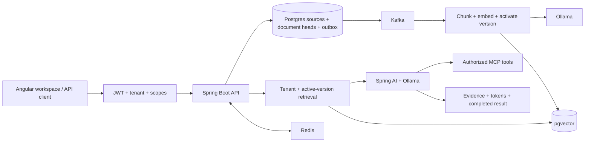

# Java-Native Agentic RAG

A local Java service with an Angular frontend that indexes synthetic support documents, answers with retrieved evidence, and exposes authorized MCP tools.



Start with the **[day-wise learning plan](docs/days/README.md)**. The [project guide](PROJECT_GUIDE.md) is the current implementation reference. The [verification ledger](docs/VERIFICATION.md) separates passing tests from pending live checks.

## Why these decisions

- Java 21, Boot 3.5.15, and Spring AI 1.1.8 preserve the compatible existing baseline; a major framework migration is separate work.
- Postgres owns data, active document versions, and event intent. Kafka delivery is at least once; database effects are idempotent.
- A replacement becomes active only after indexing succeeds. Deletion invalidates tenant response-cache keys and prevents delayed events from reviving content.
- Model inference uses local Ollama. No paid API key is required.
- Tenant-scoped exact vector search is the small-corpus baseline; the reranker is an explicit lexical/vector heuristic.

## Verification results

See [the ledger](docs/VERIFICATION.md) for the latest observed runs. No production adoption, 50,000-document benchmark, 0.87 precision, or sub-900ms full-answer latency is claimed.

Current recorded checks: **21 Java fast tests, 9 infrastructure integration tests, 29 Python evaluation tests, 3 stream-parser tests, and 5 controlled-response browser scenarios passed**. The earlier real-model API smoke also passed. The new Angular live integration check remains pending: Docker startup failed on 23 September. See the ledger for the distinction between historical results and current runtime availability.

<!-- EVAL_RESULTS_START -->
First local development run: 8 synthetic documents, 10 questions, concurrency 1. Recall@5 and expected-fact lexical coverage were 1.00; median full-answer latency was 9.75 seconds, with a 116.31-second slowest response. Faithfulness was not measured. See the [full baseline and limitations](docs/benchmarks/2026-09-22-baseline.md).
<!-- EVAL_RESULTS_END -->

## Quickstart on Windows

Prerequisite: Docker Desktop running in Linux-container mode. The first run downloads container images and approximately gigabytes of model data. Run from this folder:

```powershell
.\run.ps1
.\smoke-test.ps1
```

API health: [localhost:8081/health](http://localhost:8081/health). Grafana: [localhost:3001](http://localhost:3001). Prometheus: [localhost:9091](http://localhost:9091).

Open the **[Angular workspace](http://localhost:8081/)**. Run `.\token.ps1 | Set-Clipboard`, select Connect workspace, and paste the token. Use Documents to add synthetic text/Markdown, refresh indexing status, replace or delete sources. Use Ask your knowledge for streaming answers, retrieved evidence, and feedback. Tokens stay in memory and clear on reload. For an existing stack, rebuild with `docker compose --profile app up -d --build app`.

The frontend uses Angular 21 and Node 24 in Docker. For local development, run `.\frontend.ps1 -Action start` with compatible Node on PATH; it proxies API calls to port 8081. Build with `.\frontend.ps1` before packaging a local Java executable. See [Day 15: Angular frontend](docs/days/day-15-angular-frontend.md).

For Java development, install Java 21 on PATH:

```powershell
.\build.ps1                  # fast tests
.\build.ps1 -Integration     # also real PostgreSQL/Kafka/MCP tests; Docker required
```

`setup.ps1` creates ignored local secrets. `token.ps1` generates a development JWT. See [API examples](docs/api.md) for ingestion, queries, replacement, and deletion, and [operations](docs/operations.md) for stopping/restarting the stack.

## Scope and limitations

This is the maintained copy of an earlier personal project, reused with the user's approval. The previous folder and its data remain untouched. Fifteen learning chapters describe code that exists; additional milestones are clearly marked planned.

The service ingests JSON text, not PDFs or live company connectors. Chunking is code-point based. Indexing holds a transaction during embedding. Generated citations are not yet claim-validated. The fixture evaluation set is small and development-only. Escalations are synthetic local records with scope checks and optional query-level consent, not external tickets or durable human approvals. Cloud deployment, large-corpus measurements, and the full evaluation/release gates remain unfinished.

See [architecture decisions](docs/adr/README.md) and the [full two-project plan](../PROJECT_IMPLEMENTATION_PLAN.md).
